# DIAGRAMAS MERMAID

Todos describen la **arquitectura objetivo**. Nada de esto existe hoy en `bimartin`. Las piezas marcadas «CiDios»
existen en ese repositorio y se proponen para reutilizar.

## 1. Arquitectura general

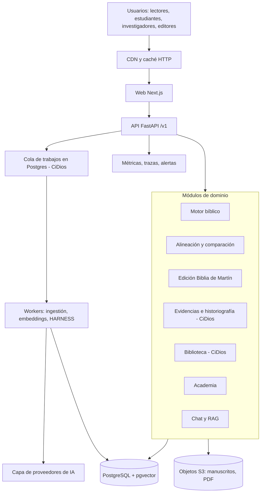

## 2. Servicios y despliegue

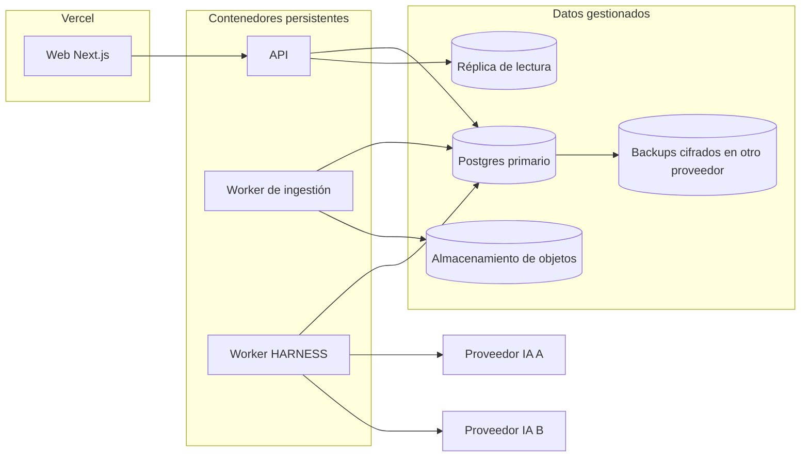

## 3. Motor bíblico

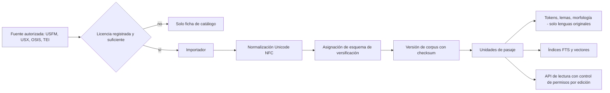

## 4. Correspondencia multiversión

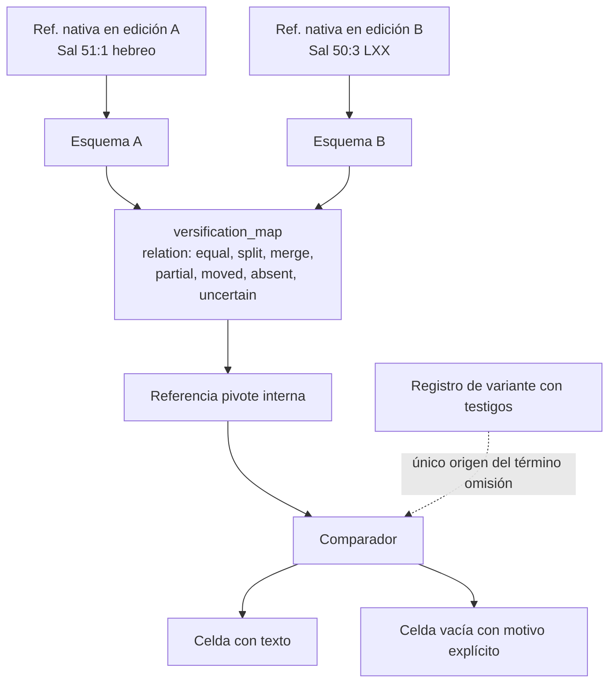

## 5. Flujo editorial

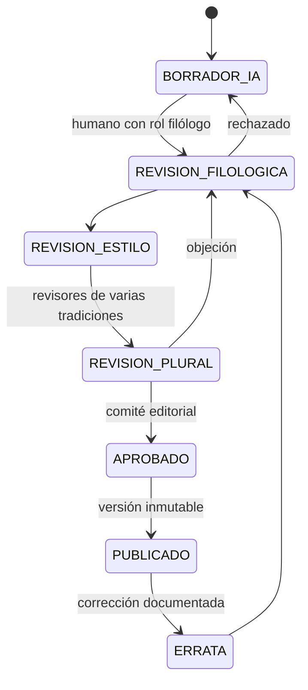

## 6. HARNESS multiagente

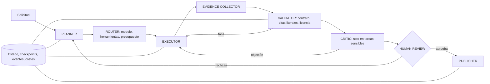

## 7. RAG

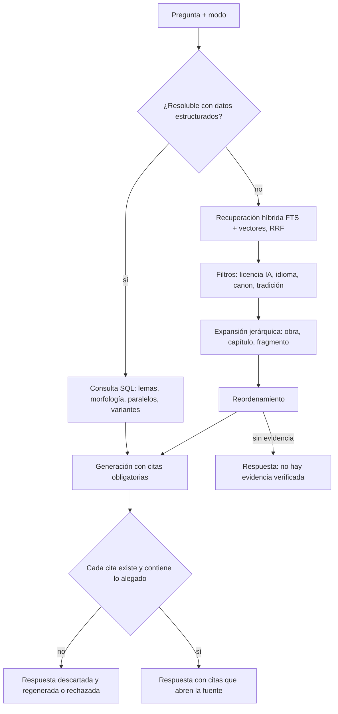

## 8. Modelo entidad-relación (núcleo)

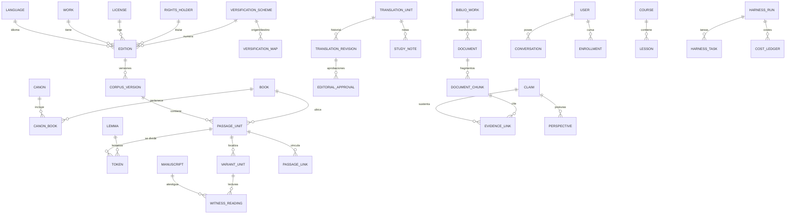

## 9. Seguridad

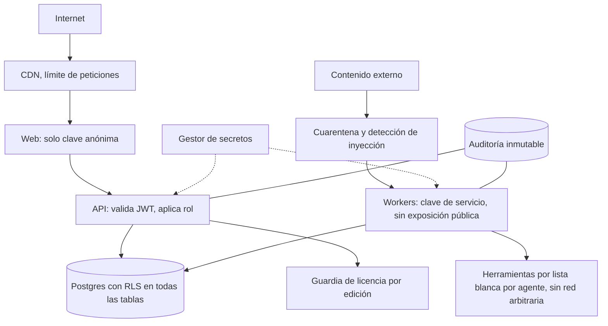

## 10. Ingestión documental

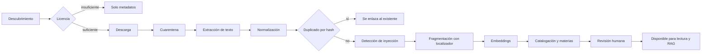

## 11. Publicación

```mermaid
sequenceDiagram
  participant E as Editor
  participant S as Sistema
  participant C as Comité editorial
  E->>S: Solicita publicar versión N
  S->>S: Valida contrato, licencias y similitud con textos protegidos
  S->>C: Presenta diff, fuentes y aprobaciones previas
  C->>S: Aprueba con firma nominal
  S->>S: Congela versión, calcula checksum, registra historial
  S-->>E: Publicado; caché invalidada
```

## 12. Backups

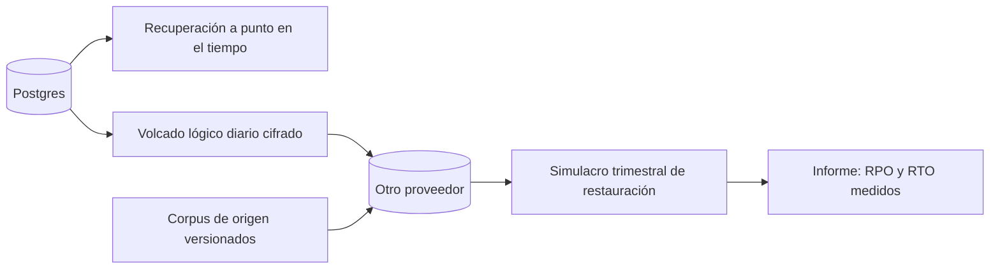

## 13. Monitorización

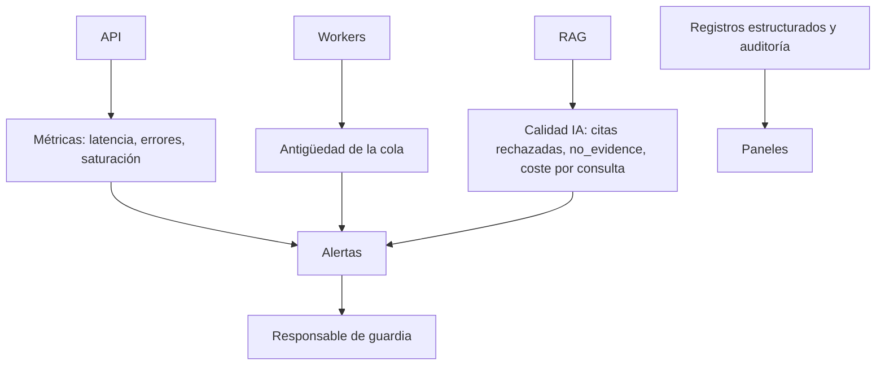

## 14. Evolución tecnológica

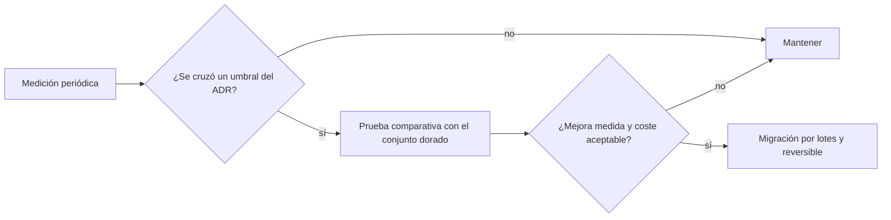
