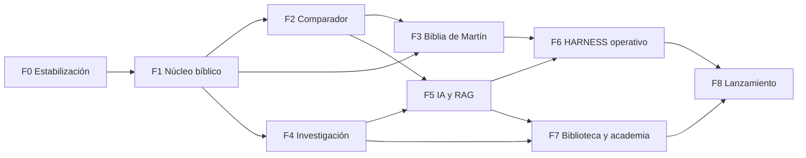

# HOJA DE RUTA MAESTRA

Punto de partida comprobado: `bimartin` vacío. Los esfuerzos son estimaciones en semanas-persona de ingeniería
(sp) para un equipo de 2–3 ingenieros; **no incluyen** el trabajo de filólogos, revisores ni abogados, que se indica
aparte. Los costes son orientativos y no proceden de presupuestos reales.

Dependencias entre fases:

## FASE 0 — Diagnóstico y estabilización

| | |
|---|---|
| Objetivos | Cerrar el riesgo de credenciales; dar a `bimartin` una base ejecutable y verificada |
| Entregables | Credenciales rotadas; `bimartin` con estructura, CI, licencia y módulos portados de CiDios; decisiones registradas (ADR) |
| Dependencias | Decisión del propietario sobre reutilizar CiDios |
| Tareas | Rotar las claves expuestas en `suscriptores`; activar escaneo de secretos; **ejecutar y reproducir** las pruebas de CiDios; portar API, HARNESS, evidencias, ingestión, RLS y CI; quitar las 19 áreas temáticas ajenas; crear proyecto Supabase de preproducción y aplicar migraciones; `LICENSE` y política de derechos |
| Aceptación | CI verde en `bimartin`; migraciones aplicadas desde cero; cero secretos detectados |
| Pruebas obligatorias | Suite heredada completa; pruebas RLS; arranque que aborta con modo desarrollo en producción |
| Riesgos | Que las pruebas de CiDios no pasen al reproducirlas; acoplamientos ocultos |
| Coste orientativo | Infraestructura mínima (decenas de USD/mes) |
| Esfuerzo | 3–4 sp |
| Finalización | Un tercero clona `bimartin`, sigue el README y obtiene la suite en verde |

## FASE 1 — Núcleo bíblico

| | |
|---|---|
| Objetivos | Almacenar y leer Biblias con derechos correctos |
| Entregables | Esquema de obras, ediciones, cánones, libros, unidades de pasaje; importadores USFM y OSIS; analizador de referencias; lector web; 5–10 ediciones abiertas, incluidos hebreo y griego |
| Dependencias | F0; verificación de licencias de cada edición |
| Tareas | Migraciones seguras 1–3 (AUDITORIA_SUPABASE.md §4); guardia de licencia al servir; normalización Unicode y columna de búsqueda; RTL y tipografías; caché por versión |
| Aceptación | Invariantes de corpus en verde para cada edición; una edición `CATALOG_ONLY` nunca devuelve texto; p95 de capítulo < 200 ms |
| Pruebas | Invariantes, ida y vuelta, analizador de referencias, licencias, accesibilidad del lector |
| Riesgos | Licencias mal entendidas; formatos de origen sucios |
| Coste | Bajo en infraestructura; horas de abogado para validar licencias |
| Esfuerzo | 8–10 sp |
| Finalización | Lector público de preproducción con ediciones abiertas y ficha de derechos visible en cada una |

## FASE 2 — Comparador universal

| | |
|---|---|
| Objetivos | Comparar cualquier pasaje entre ediciones con numeraciones y cánones distintos |
| Entregables | Esquemas de versificación y mapa; vista paralela; matriz de diferencias; lemas y morfología para lenguas originales; exportación con citas |
| Dependencias | F1 |
| Tareas | Migraciones 4–6; ingestión de datos morfológicos abiertos; diff por palabras; celdas vacías con motivo; vista interlineal |
| Aceptación | Los 14 casos filológicos pasan; «omisión» solo con registro de variante; comparación de 8 ediciones p95 < 500 ms |
| Pruebas | Alineación, cánones, coherencia del mapa, RTL |
| Riesgos | Calidad y licencia de las tablas de versificación; correspondencias inciertas |
| Esfuerzo | 10–12 sp, más revisión de un filólogo |
| Finalización | Un filólogo valida una muestra aleatoria de 200 alineaciones sin errores graves |

## FASE 3 — Biblia de Martín

| | |
|---|---|
| Objetivos | Producir un libro piloto con proceso editorial completo |
| Entregables | Política de traducción publicada; flujo editorial con estados y firmas; control de similitud; un libro breve publicado (p. ej. Jonás o Filemón) con notas y registro de decisiones |
| Dependencias | F1, F2; **equipo editorial humano contratado** |
| Tareas | Migración 7; interfaz de revisión; borrador asistido solo desde lengua original; historial y erratas |
| Aceptación | Cada versículo publicado tiene texto base, fuentes, borrador, revisiones y aprobaciones nominales; ninguna transición editorial hecha por un agente |
| Pruebas | Editoriales (ESTRATEGIA_TESTING §5) |
| Riesgos | No disponer de revisores cualificados; reproducción involuntaria de traducciones protegidas |
| Coste | Dominado por honorarios de especialistas |
| Esfuerzo | 8–10 sp de ingeniería; el trabajo editorial se mide aparte y es mayor |
| Finalización | Libro piloto publicado y auditado externamente por un biblista ajeno al equipo |

## FASE 4 — Investigación avanzada

| | |
|---|---|
| Objetivos | Fuentes, historiografía, manuscritos y grafo de conocimiento sobre datos revisados |
| Entregables | Tablas de manuscritos, testigos y variantes; cronologías y mapas con cartografía; biblioteca con metadatos ricos; vínculos pasaje-recurso |
| Dependencias | F1 |
| Tareas | Migración 6 y parte de la 8; almacenamiento de objetos; conectores probados contra servicios reales; revisión experta del corpus semilla, con páginas |
| Aceptación | Toda afirmación publicada tiene evidencia verificada y categoría epistémica; referencias resueltas o cotejadas |
| Riesgos | Corpus sin revisar; derechos de imágenes |
| Esfuerzo | 10–12 sp, más historiador revisor |
| Finalización | Módulo de transmisión textual revisado y firmado por un especialista |

## FASE 5 — Inteligencia artificial

| | |
|---|---|
| Objetivos | Chat con citas verificables |
| Entregables | Conversaciones; RAG con filtros de licencia; embeddings multilingües; reordenamiento; verificación de citas; seis modos; conjunto dorado |
| Dependencias | F2, F4 |
| Tareas | Interfaz de proveedores; tabla de embeddings por modelo; clasificador de consulta; evaluación en CI; límites de cita |
| Aceptación | Umbrales de ESTRATEGIA_TESTING §4.2; **0 citas inexistentes** |
| Riesgos | Coste por consulta; calidad en hebreo y griego |
| Coste | Proporcional al uso; medir desde el primer día |
| Esfuerzo | 10–12 sp, más especialistas para el conjunto dorado |
| Finalización | Conjunto dorado en verde durante dos semanas seguidas |

## FASE 6 — HARNESS operativo

| | |
|---|---|
| Objetivos | Las familias de agentes necesarias funcionando con fichas completas |
| Entregables | Fichas de las familias priorizadas; contratos validados por tarea; plazos y topes; panel de costes y trazas |
| Dependencias | F3, F5 |
| Tareas | Cambios del motor (AUDITORIA_HARNESS §6); empezar por las familias 1, 3, 6, 14, 15, 18, 19 y 20 |
| Aceptación | Cada familia operativa cumple su ficha y sus casos de aceptación; ninguna publica sin política editorial |
| Riesgos | Proliferación de agentes sin ganancia medible |
| Esfuerzo | 8–10 sp |
| Finalización | Recuperación de una ejecución interrumpida demostrada; presupuesto que corta en una prueba |

## FASE 7 — Biblioteca y academia

| | |
|---|---|
| Objetivos | Catálogo interoperable y un programa formativo piloto |
| Entregables | Catálogo con exportación; grafo navegable; LMS con cursos, lecciones, evaluaciones, progreso y certificados de participación; tutor IA |
| Dependencias | F4, F5 |
| Tareas | Resto de la migración 8; diseño curricular con docentes; investigación de cursos externos y sus condiciones |
| Aceptación | Un curso completo impartido a un grupo piloto; certificados sin lenguaje de acreditación |
| Riesgos | Contenido docente sin autor cualificado |
| Esfuerzo | 10–12 sp, más docentes |
| Finalización | Evaluación del piloto por sus participantes y por un docente externo |

## FASE 8 — Lanzamiento

| | |
|---|---|
| Objetivos | Producción segura, medida y recuperable |
| Entregables | Prueba de penetración; pruebas de carga; backups ensayados; monitorización y guardias; revisión legal; política de privacidad |
| Dependencias | F6, F7 |
| Tareas | Endurecimiento; CDN; límites distribuidos; exportación y borrado de datos; plan de incidentes |
| Aceptación | Criterios de AUDITORIA_SEGURIDAD §8; objetivos de rendimiento; restauración ensayada |
| Riesgos | Hallazgos tardíos de seguridad o legales |
| Coste | Auditoría externa y revisión legal |
| Esfuerzo | 6–8 sp |
| Finalización | Lista de comprobación de lanzamiento firmada por ingeniería, edición y legal |

## Total y lectura honesta

Ingeniería: unas 75–90 semanas-persona, es decir, del orden de 8–12 meses con tres ingenieros si las fases
paralelas se solapan. Es una estimación gruesa hecha sin equipo ni velocidad conocidos.

La traducción completa de la Biblia con revisión cualificada **no cabe en este calendario**: es un proyecto de
años. La hoja de ruta entrega un libro piloto y el sistema para continuar libro a libro.
