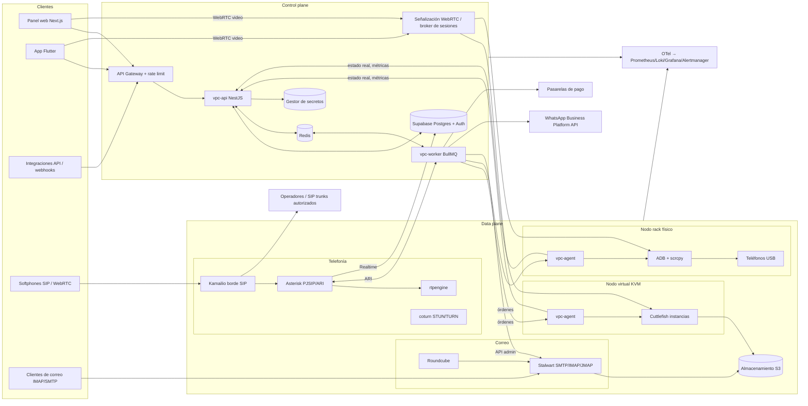
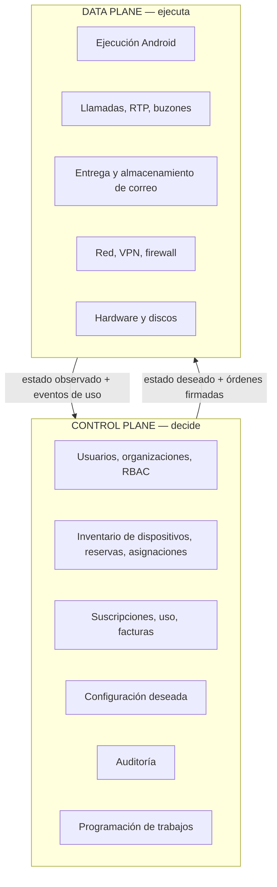
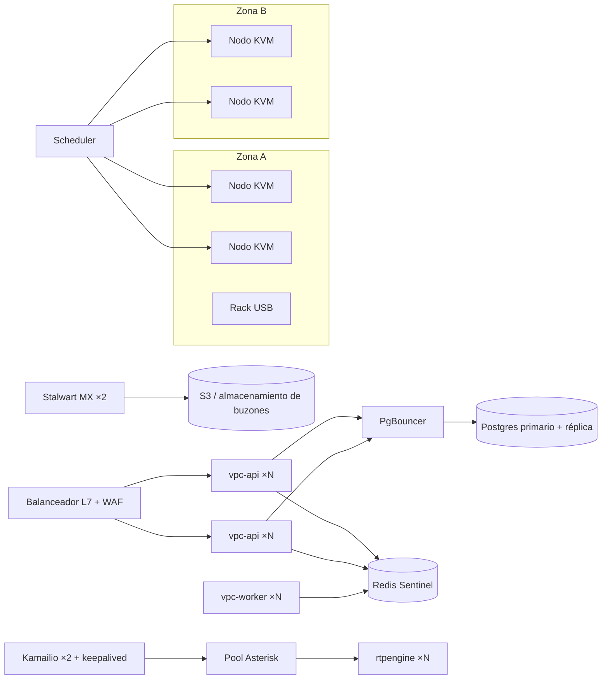

# 01 · Arquitectura

## 1. Arquitectura general

VPC es un conjunto de **módulos de dominio independientes** unidos por **VPC Core**. Cada módulo
tiene su propio esquema de base de datos (`core`, `vphone`, `mphone`, `mmail`, `identity`,
`verify`, `network`, `billing`, `whatsapp_biz`), su propio módulo NestJS y su propio conjunto de
trabajos en cola. Se comunican por:

- **Llamadas síncronas** dentro del control plane (módulo → servicio público de otro módulo, nunca
  acceso directo a sus tablas).
- **Eventos de dominio** (`device.started`, `mailbox.created`, `call.completed`, `usage.recorded`…)
  publicados en una tabla *outbox* transaccional y distribuidos por BullMQ. Así facturación,
  auditoría e identidad reaccionan sin acoplarse.

Hay tres tipos de proceso:

| Proceso | Dónde corre | Qué hace |
|---|---|---|
| `vpc-api` (NestJS) | Control plane | REST/WebSocket/OpenAPI, RBAC, multi-tenancy, orquestación |
| `vpc-worker` (NestJS + BullMQ) | Control plane | Trabajos largos e idempotentes: aprovisionar, facturar, sincronizar |
| `vpc-agent` (Go) | Cada nodo del data plane | Ejecuta órdenes locales (libvirt/Cuttlefish, ADB, métricas), informa estado real |

Los motores especializados (Cuttlefish, Asterisk, Stalwart) **no se reescriben**: el control plane
los administra mediante sus interfaces oficiales (agente, ARI/Realtime, API de administración).

### Monorepo propuesto

```
vpc/
  apps/web          Next.js (panel Control Center + portal de clientes)
  apps/api          NestJS (vpc-api + vpc-worker; módulos por dominio)
  apps/mobile       Flutter
  agents/node-agent Go (vpc-agent)
  packages/contracts  OpenAPI + tipos generados + esquemas de eventos
  database/migrations  SQL versionado (Supabase)
  infra/            Ansible/Terraform, compose de servicios, dashboards Grafana
  docs/             estos documentos + ADR
```

## 2. Diagrama de componentes



## 3. Control plane / data plane



Reglas de diseño:

1. **Estado deseado vs. observado.** El control plane guarda lo que *debería* existir
   (`devices.desired_state = running`); solo el agente escribe lo que *existe*
   (`devices.observed_state`, `last_seen_at`). La UI muestra el observado. Así nunca se pinta
   "conectado" sin confirmación.
2. **Autonomía del data plane.** Si `vpc-api` cae:
   - Las instancias Android siguen corriendo; sus discos están en el nodo/S3, no en el panel.
   - Asterisk sigue cursando llamadas con su configuración Realtime cacheada (`rtcache`) y
     Kamailio con su tabla de enrutamiento en memoria.
   - Stalwart sigue recibiendo y entregando correo; sus datos no dependen del panel.
   - Lo que se pierde temporalmente: crear/borrar recursos, abrir sesiones nuevas, facturación en
     vivo. Los eventos de uso se acumulan en el agente/motor y se envían al recuperarse
     (entrega *al menos una vez*, deduplicados por `event_id`).
3. **Conexiones siempre salientes desde el nodo.** El agente abre un canal mTLS (gRPC/WebSocket)
   hacia el control plane. Los racks pueden estar detrás de NAT sin abrir puertos.
4. **Órdenes idempotentes.** Cada orden lleva `job_id`; el agente la registra y no la repite.

## 4. Arquitectura de infraestructura

### Etapa 1 (laboratorio, 5 dispositivos)

| Rol | Recurso | Notas |
|---|---|---|
| Control plane | 1 VPS (4 vCPU / 8 GB) + Supabase gestionado | `vpc-api`, `vpc-worker`, Redis, Grafana |
| Nodo virtual | 1 servidor dedicado con KVM (≥16 núcleos, ≥64 GB, NVMe) | Cuttlefish; capacidad real a medir |
| Rack físico | 1 mini-PC Linux + hub USB alimentado + 2–3 teléfonos | `vpc-agent` + ADB |
| Telefonía | 1 VPS (2 vCPU / 4 GB) con IP pública fija | Asterisk + coturn; solo extensiones internas |
| Correo | 1 VPS (4 vCPU / 8 GB) con IP fija, **PTR configurable**, puerto 25 abierto | Stalwart + Roundcube |
| Backups | Almacenamiento S3 externo (otro proveedor/región) | Cifrado del lado del cliente |

### Etapa 4–6 (300–1.000+ dispositivos)



- Orquestación: **Nomad** para servicios auxiliares cuando haya > 5 nodos (más simple que
  Kubernetes para cargas mixtas VM/binario). Kubernetes solo si el equipo ya lo opera.
- Las VMs Android **no** se ejecutan en contenedores Docker: corren como procesos KVM gestionados
  por el agente. Docker se usa para servicios auxiliares (Redis, Grafana, Roundcube, coturn).

## 5. Decisiones de arquitectura (ADR)

### ADR-001 · Virtualización Android: Cuttlefish

| Opción | Evaluación |
|---|---|
| **Cuttlefish (AOSP, KVM/crosvm o QEMU)** | ✅ Elegida. Pensado para servidores; varias instancias por host; WebRTC integrado para pantalla/entrada; ADB nativo; imágenes AOSP con licencia Apache 2.0. |
| Android Emulator (goldfish/ranchu) | Útil para desarrollo; más orientado a escritorio; gRPC/WebRTC disponible pero menos pensado para multi-instancia en servidor. Se mantiene para laboratorio. |
| QEMU puro con Android-x86 | Proyecto con mantenimiento irregular, compatibilidad ARM limitada. Descartado. |
| Redroid (Android en contenedor) | Comparte kernel del host: aislamiento insuficiente entre clientes. Descartado para multi-tenant. |
| Genymotion SaaS/On-Premise | Posible como capacidad extra contratada si su licencia comercial permite reventa. Requiere revisión legal; no es la base. |

Limitaciones a declarar al cliente: sin Google Play (ver README), sin SIM, sin IMEI real, sin
radio celular. El modelo se reporta como el que es (dispositivo virtual Cuttlefish).
Apps ARM-only pueden no funcionar en hosts x86: se ofrecerán **nodos ARM64** (p. ej. Ampere) si la
demanda lo justifica.

### ADR-002 · Dispositivos físicos: ADB + scrcpy

ADB por USB (no ADB por Wi-Fi abierto). scrcpy-server (Apache 2.0) captura H.264 en el teléfono; el
agente lo reempaqueta en WebRTC. Hub USB alimentado con control de puertos (uhubctl) para
reinicio físico de puertos.

### ADR-003 · Telefonía: Asterisk

| Opción | Evaluación |
|---|---|
| **Asterisk 22 LTS + PJSIP** | ✅ Elegida. `res_pjsip` con **Realtime PostgreSQL** (`ps_endpoints`, `ps_auths`, `ps_aors`) ⇒ las extensiones se crean escribiendo filas desde el control plane, sin recargar ficheros. **ARI** (REST + WebSocket) para lógica de llamadas controlada desde NestJS. WebRTC nativo (`webrtc=yes`). Gran comunidad. |
| FreeSWITCH | Multi-tenancy por dominio muy buena y alto rendimiento de media. Descartado como principal por menor disponibilidad de talento y licencia/soporte de la versión comercial; se reevaluará si una sola instancia de Asterisk no escala en Etapa 5. |
| FreePBX | Interfaz propia que duplicaría el panel VPC y gestiona Asterisk con ficheros; choca con la configuración desde base de datos. Descartado. |

Multi-tenancy en Asterisk: cada organización tiene su propio *context* de dialplan generado
(`org_<uuid>`); nadie puede marcar fuera de su contexto. Desde Etapa 3, **Kamailio** al frente
(registro, anti-flood con `pike`, límites por cuenta, enrutamiento a varios Asterisk) y
**rtpengine** para media/SRTP. **coturn** para WebRTC tras NAT.

### ADR-004 · Correo: Stalwart + Roundcube

| Opción | Evaluación |
|---|---|
| **Stalwart Mail Server** | ✅ Elegida. Un binario con SMTP, Submission, IMAP4rev2, JMAP, DKIM/ARC/SPF/DMARC, MTA-STS, DANE, antispam y filtros integrados, **API REST de administración** (cuentas, dominios, cuotas, alias) y almacenamiento en PostgreSQL/S3. Encaja con aprovisionamiento desde el control plane. |
| Postfix + Dovecot + Rspamd | Pila probadísima; alternativa B documentada si Stalwart muestra problemas en pruebas de carga. Tres componentes con su propia configuración. |
| mailcow / Mailu | Empaquetan la pila anterior con su propio panel y su propia base de datos de usuarios: duplicaríamos el panel de cuentas. Descartados. |
| Roundcube | ✅ Webmail sobre IMAP (Stalwart no sustituye un webmail completo). |

Antimalware: ClamAV vía milter/integración de Stalwart (a validar en Fase 5).
Entregabilidad: IP dedicada con PTR, calentamiento progresivo de IP, SPF/DKIM/DMARC `p=quarantine`
→ `p=reject`, reportes DMARC agregados procesados, monitorización de listas de bloqueo,
límites de envío por buzón. **Crear una cuenta no garantiza entregar en Gmail/Outlook**: se mide.

### ADR-005 · Agente de nodo en Go

Necesita libvirt/Cuttlefish CLI, ADB, uhubctl, lectura de sensores y un canal persistente. Go da un
binario estático sin runtime, fácil de desplegar en racks. Contrato del canal definido en
`packages/contracts` (protobuf), compartido con NestJS.

### ADR-006 · Supabase solo como control plane

Supabase guarda usuarios, organizaciones, permisos, inventario, identidades, facturación y la tabla
Realtime de PJSIP (en un esquema aislado con usuario de solo lectura para Asterisk). No guarda
imágenes de disco, buzones de correo ni grabaciones: eso va a los nodos/S3.

### ADR-007 · WhatsApp: dos módulos separados

- **WhatsApp Messenger en dispositivos:** una app más en el catálogo de instalación. VPC no promete
  verificación; la tabla `phone_numbers` declara capacidades reales (`sms`, `voice`, `mobile_sim`,
  `voip_public`, `internal_sip`).
- **WhatsApp Business Platform (Cloud API oficial):** módulo `whatsapp_biz` independiente
  (cuentas, números, plantillas, webhooks firmados, agentes, consentimientos). No necesita ningún
  Android virtual.
