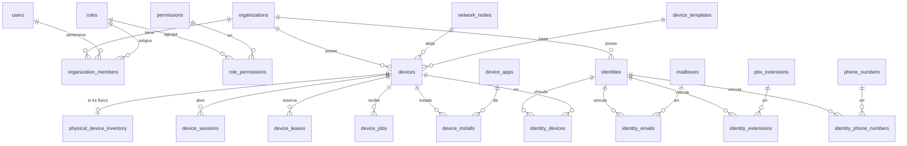
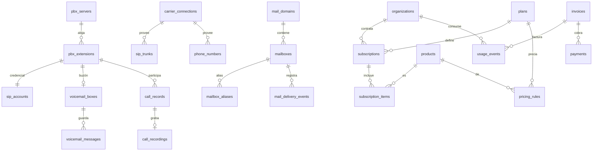

# 02 · Modelo de datos

PostgreSQL (Supabase), normalizado, multi-tenant. Convenciones:

- **PK `uuid`** (`gen_random_uuid()`) en todas las tablas. Nunca correo ni número como PK.
- Toda tabla de cliente tiene `organization_id uuid not null` + índice + **RLS**.
- `created_at`, `updated_at timestamptz`; borrado lógico con `deleted_at` donde haya facturación o
  auditoría asociada.
- Estados como `text` con `check` (más fácil de migrar que `enum`).
- Dinero en **centavos `bigint`** + `currency char(3)`.
- Secretos (contraseñas SIP, credenciales de trunk, tokens) **no** se guardan en tablas expuestas:
  se guarda una referencia `secret_ref` al gestor de secretos.
- Un esquema por dominio: `core`, `identity`, `vphone`, `mphone`, `mmail`, `verify`, `network`,
  `billing`, `whatsapp_biz`. Solo `vpc-api` (service role) escribe; el cliente lee vía API.
- Cambios de estado que muevan dinero o recursos se hacen con **funciones SQL atómicas**
  `security definer`, `search_path` fijo, `revoke` a `anon/authenticated`.

## Tablas por dominio

### core — usuarios y organizaciones

| Tabla | Columnas clave |
|---|---|
| `users` | `id` (= `auth.users.id`), `display_name`, `status` (`active/suspended`), `mfa_required` |
| `organizations` | `id`, `name`, `slug` único, `kind` (`platform/customer`), `status`, `country`, `billing_email` |
| `roles` | `id`, `organization_id` nulo = rol de sistema, `key` (`superadmin`, `platform_admin`, `org_admin`, `supervisor`, `operator`, `user`, `auditor`), `name` |
| `permissions` | `id`, `key` (`device.power`, `mailbox.create`…), `description`, `scope` (`platform/org`) |
| `role_permissions` | `role_id`, `permission_id` (PK compuesta) |
| `organization_members` | `id`, `organization_id`, `user_id`, `role_id`, `status`, único (`organization_id`,`user_id`) |
| `user_sessions` | `id`, `user_id`, `organization_id`, `ip`, `user_agent`, `mfa_level`, `expires_at`, `revoked_at` |
| `audit_logs` | `id`, `organization_id`, `actor_user_id`, `actor_kind` (`user/api_key/system/ai`), `action`, `target_type`, `target_id`, `before jsonb`, `after jsonb`, `ip`, `created_at`. **Solo inserción** (sin update/delete, ni para service role vía trigger) |
| `api_keys` | `id`, `organization_id`, `prefix`, `secret_hash`, `scopes text[]`, `last_used_at`, `expires_at`, `revoked_at` |
| `outbox_events` | `id`, `type`, `payload jsonb`, `created_at`, `published_at` |

### vphone — dispositivos

| Tabla | Columnas clave |
|---|---|
| `network_nodes` (esquema `network`) | `id`, `name`, `kind` (`kvm/usb_rack/telephony/mail`), `location`, `arch` (`x86_64/arm64`), `cpu_cores`, `ram_mb`, `disk_gb`, `status`, `agent_version`, `last_seen_at`, `cert_fingerprint` |
| `device_templates` | `id`, `organization_id` nulo = global, `name`, `android_version`, `image_ref`, `vcpus`, `ram_mb`, `disk_gb`, `width`, `height`, `dpi`, `has_gms` (false salvo licencia) |
| `devices` | `id`, `organization_id`, `code` (`VPHONE-0001`, único), `kind` (`virtual/physical`) **inmutable**, `node_id`, `template_id`, `desired_state`, `observed_state` (`provisioning/running/stopped/error/disconnected/suspended/reserved`), `observed_at`, `ip_address inet`, `android_version`, `manufacturer`, `model` (los reales; en virtual = "Cuttlefish"), `locked` |
| `physical_device_inventory` | `id`, `device_id` único, `serial`, `usb_port`, `rack_slot`, `battery_pct`, `battery_temp_c`, `last_hw_report_at`, `purchase_date` |
| `device_sessions` | `id`, `device_id`, `user_id`, `mode` (`view/control`), `started_at`, `ended_at`, `expires_at`, `client_ip` |
| `device_leases` | `id`, `device_id`, `organization_id`, `assignee_user_id`, `billing_unit` (`hour/day/month`), `starts_at`, `ends_at`, `status`, `usage_limit_minutes`, exclusión por rango (`exclude using gist`) para evitar dos reservas solapadas |
| `device_jobs` | `id`, `device_id`, `kind` (`create/start/stop/reboot/install/snapshot/restore/delete`), `payload`, `status` (`queued/sent/running/succeeded/failed`), `idempotency_key` único, `requested_by`, `error`, timestamps |
| `device_snapshots` | `id`, `device_id`, `storage_ref`, `size_bytes`, `created_at` |
| `device_metrics` | `device_id`, `ts`, `cpu_pct`, `ram_mb`, `disk_used_mb`, `net_rx_bytes`, `net_tx_bytes` (particionada por mes; los detalles finos van a Prometheus) |
| `device_apps` | `id`, `organization_id`, `package_name`, `version`, `apk_storage_ref`, `sha256`, `approved_by`, `license_note` |
| `device_installs` | `id`, `device_id`, `app_id`, `status`, `job_id` |
| `device_network_profiles` | `device_id`, `network_profile_id` |

### identity — identidades

| Tabla | Columnas clave |
|---|---|
| `identities` | `id`, `organization_id`, `label`, `owner_user_id`, `status` (`active/suspended/revoked`) |
| `identity_devices` | `identity_id`, `device_id`, `linked_at`, `unlinked_at` (histórico, no se borra) |
| `identity_emails` | `identity_id`, `mailbox_id`, `verified_at`, `is_primary` |
| `identity_phone_numbers` | `identity_id`, `phone_number_id`, `verified_at` |
| `identity_extensions` | `identity_id`, `extension_id` |
| `identity_verifications` | `id`, `identity_id`, `factor` (`email/sms/totp/webauthn`), `status`, `verified_at` |
| `identity_recovery_events` | `id`, `identity_id`, `requested_by`, `method`, `status`, `approved_by`, `created_at` |

Restricción: una extensión/buzón/número activo solo puede estar vinculado a **una** identidad activa
(índice único parcial `where unlinked_at is null`).

### mphone — telefonía

| Tabla | Columnas clave |
|---|---|
| `pbx_servers` | `id`, `node_id`, `engine` (`asterisk`), `version`, `ari_url`, `ari_secret_ref`, `status` |
| `pbx_extensions` | `id`, `organization_id`, `pbx_server_id`, `number` (único por organización), `display_name`, `department`, `status`, `max_concurrent_calls`, `allowed_destinations` (`internal/national/international`) |
| `sip_accounts` | `id`, `extension_id`, `username`, `secret_ref`, `transport` (`tls/wss`), `webrtc bool` — se proyecta a las tablas `ps_*` mediante vista/trigger |
| `phone_numbers` | `id`, `e164` único, `organization_id` nulo = no asignado, `carrier_connection_id`, `kind` (`voip_public/mobile_sim`), `capabilities text[]` (`voice/sms`), `status` (`pending/active/suspended/released`), `activated_at` — `active` solo con confirmación del operador |
| `carrier_connections` | `id`, `name`, `country`, `contract_ref`, `authorized_by`, `status` |
| `sip_trunks` | `id`, `carrier_connection_id`, `host`, `auth_secret_ref`, `codecs`, `max_channels`, `status` |
| `call_routes` | `id`, `organization_id`, `kind` (`inbound/outbound`), `match_pattern`, `target_type`, `target_id`, `priority`, `schedule_id` |
| `voicemail_boxes` / `voicemail_messages` | buzón por extensión; mensajes con `storage_ref`, `duration_s`, `heard_at` |
| `call_records` | `id`, `organization_id`, `call_uuid` único, `direction`, `from`, `to`, `extension_id`, `trunk_id`, `started_at`, `answered_at`, `ended_at`, `billsec`, `disposition`, `mos` (calidad), `cost_cents` (particionada por mes) |
| `call_recordings` | `id`, `call_record_id`, `storage_ref`, `consent_basis`, `retention_until` |
| `telephony_rate_plans` | `id`, `name`, `prefix`, `cost_per_min_cents`, `price_per_min_cents`, `min_billable_s`, `increment_s` |
| `telephony_usage` | `id`, `organization_id`, `period`, `minutes`, `cost_cents` |

### mmail — correo

| Tabla | Columnas clave |
|---|---|
| `mail_domains` | `id`, `organization_id` nulo = dominio de plataforma, `domain` único, `verified_at`, `dkim_selector`, `spf_ok`, `dmarc_ok`, `mta_sts_ok`, `status` |
| `mailboxes` | `id`, `organization_id`, `domain_id`, `local_part`, único (`domain_id`,`local_part`), `stalwart_principal_id`, `status` (`active/suspended/deleted`), `quota_mb`, `send_limit_per_hour` |
| `mailbox_aliases` | `id`, `mailbox_id`, `domain_id`, `local_part` |
| `mailbox_quotas` | `mailbox_id`, `used_mb`, `measured_at` (lo informa Stalwart) |
| `mailbox_sessions` | `id`, `mailbox_id`, `protocol`, `ip`, `client`, `started_at`, `revoked_at` |
| `mail_events` | `id`, `mailbox_id`, `kind` (`received/sent/login/password_change`), `ts` |
| `mail_delivery_events` | `id`, `message_id`, `mailbox_id`, `recipient_domain`, `status` (`queued/delivered/deferred/bounced`), `smtp_code`, `ts` — **"entregado" solo con evento del MTA** |
| `mail_security_events` | `id`, `mailbox_id`, `kind` (`spam_out/malware/brute_force/compromised_suspect`), `details`, `ts` |
| `mail_usage` | `organization_id`, `period`, `messages_sent`, `messages_received`, `storage_mb` |

### verify — verificación propia de VPC

| Tabla | Columnas clave |
|---|---|
| `verification_channels` | `id`, `kind` (`email/sms/voice`), `provider`, `status` |
| `otp_challenges` | `id`, `user_id`/`identity_id`, `channel`, `destination_hash`, `code_hash` (HMAC-SHA256 con pepper), `purpose` (`login/recovery/mfa_enroll`), `expires_at`, `attempts`, `max_attempts`, `consumed_at` |
| `verification_attempts` | `id`, `challenge_id`, `ip`, `success`, `ts` |
| `verification_events` | `id`, `challenge_id`, `kind` (`sent/delivered/failed`), `ts` |
| `abuse_detection_events` | `id`, `subject_type`, `subject_id`, `rule`, `score`, `action` (`log/throttle/block`), `ts` |

### network

`network_profiles` (`id`, `organization_id`, `name`, `vlan_id`, `subnet cidr`, `egress` (`nat/dedicated_ip/vpn`), `bandwidth_kbps`, `dns_servers`), `network_interfaces`, `firewall_policies` (`profile_id`, `direction`, `proto`, `cidr`, `port_range`, `action`, `priority`), `vpn_connections` (`profile_id`, `kind` `wireguard`, `peer_public_key`, `secret_ref`), `network_metrics` (`node_id`/`device_id`, `ts`, `latency_ms`, `loss_pct`, `rx`, `tx`).

### billing — comercial

| Tabla | Columnas clave |
|---|---|
| `products` | `id`, `key` (`vphone_basic`, `vphone_advanced`, `vphone_physical`, `extension`, `public_number`, `minutes`, `voicemail`, `mailbox`, `storage_gb`, `api`…), `unit` (`hour/day/month/minute/gb/unit`) |
| `plans` | `id`, `key` (`free/basic/pro/enterprise/custom`), `organization_id` nulo = público, `currency`, `period` |
| `pricing_rules` | `id`, `plan_id`, `product_id`, `unit_price_cents`, `unit_cost_cents`, `included_qty`, `min_margin_bps`, `below_cost_approved_by` (obligatorio si precio < coste) |
| `subscriptions` | `id`, `organization_id`, `plan_id`, `status` (`trialing/active/past_due/canceled`), `current_period_start/end` |
| `subscription_items` | `id`, `subscription_id`, `product_id`, `quantity`, `resource_type`, `resource_id` |
| `usage_events` | `id`, `event_id` **único** (deduplicación), `organization_id`, `product_id`, `quantity numeric`, `resource_id`, `occurred_at`, `invoice_id` |
| `invoices` | `id`, `organization_id`, `number` único, `period`, `subtotal_cents`, `tax_cents`, `total_cents`, `status` (`draft/open/paid/void`), `issued_at` |
| `payments` | `id`, `invoice_id`, `provider`, `provider_ref` único, `amount_cents`, `status`, `received_at` |
| `customer_balances` | `organization_id` PK, `available_cents`, `reserved_cents` + ledger `balance_transactions` (`reference` única, idempotente) |

### whatsapp_biz

`wa_business_accounts`, `wa_phone_numbers` (vinculados vía Meta, con `quality_rating`, `messaging_limit_tier`), `wa_templates`, `wa_conversations`, `wa_messages`, `wa_agents`, `wa_assignments`, `wa_consents` (`contact_hash`, `source`, `opted_in_at`, `opted_out_at`), `wa_webhook_events` (`event_id` único, payload, `signature_ok`).

## Diagramas de relaciones

### Núcleo, dispositivos e identidad



### Telefonía, correo y facturación



## RLS (patrón)

```sql
-- Función auxiliar: organizaciones del usuario autenticado
create function core.user_org_ids() returns setof uuid
  language sql stable security definer set search_path = core as $$
  select organization_id from core.organization_members
  where user_id = auth.uid() and status = 'active'
$$;

alter table vphone.devices enable row level security;
create policy devices_tenant_read on vphone.devices
  for select to authenticated
  using (organization_id in (select core.user_org_ids()));
-- Escrituras: sin política para authenticated ⇒ solo vpc-api (service role) vía funciones auditadas.
```

Los permisos finos (rol + permiso) se verifican en `vpc-api`; RLS es la segunda barrera que
garantiza el aislamiento entre organizaciones aunque haya un fallo en la API.
