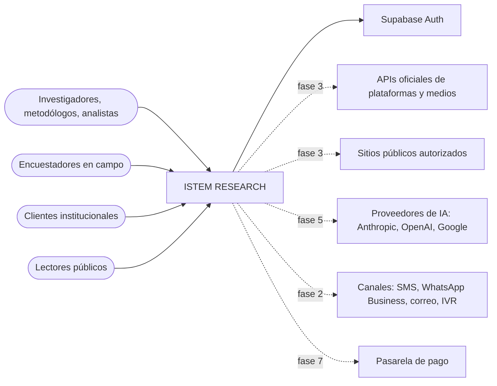
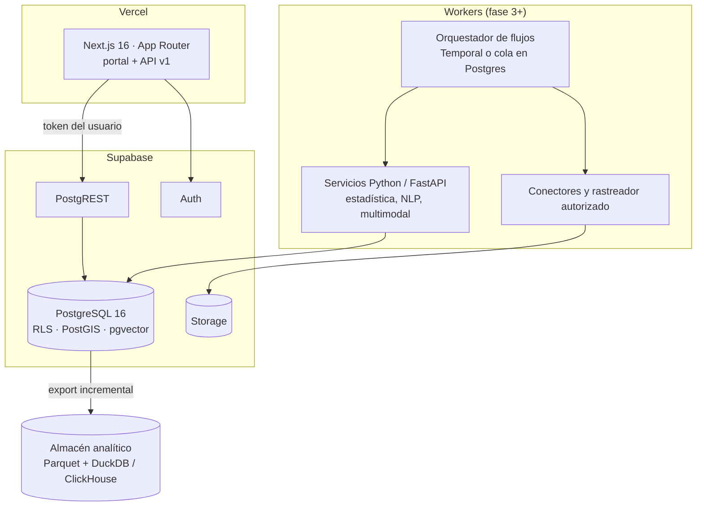
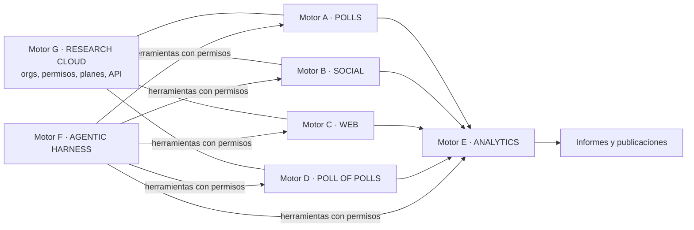

# 03 · Arquitectura (C4, servicios, flujos de datos y decisiones)

## 1. Contexto (C4 nivel 1)



## 2. Contenedores (C4 nivel 2)



**Implementado en fase 1:** el contenedor Next.js y el esquema PostgreSQL. Los workers y el almacén analítico son de fases posteriores.

## 3. Componentes de la fase 1 (C4 nivel 3)

| Componente | Archivo | Responsabilidad |
|---|---|---|
| Proxy de sesión | `proxy.ts` | Redirige sin sesión, renueva el token con el refresh token |
| Cliente Supabase | `lib/supabase.ts` | Auth + PostgREST con el **token del usuario**; traduce `PTxxx` a errores visibles |
| Sesión del portal | `lib/session.ts` | Usuario, membresías, organización activa (cookie validada) |
| Acceso a datos | `lib/data.ts` | Consultas tipadas; todas sujetas a RLS |
| Reglas de proyecto | `lib/project-rules.ts` | Validación y transiciones (espejo de SQL, probado) |
| Núcleo metodológico | `lib/methodology.ts`, `lib/simulator.ts` | Tamaño muestral, margen, Kish, raking, asignación, advertencias |
| API v1 | `app/api/v1/*` | REST para organizaciones, miembros, proyectos, auditoría, geo, simulador |
| Seguridad en BD | `database/migrations/001_fundamentos.sql` | RLS, RPC `security definer`, auditoría encadenada |

## 4. Diagrama de servicios (objetivo, siete motores)



Contratos: cada motor expone una API versionada (`/api/v1/<motor>/…`) y publica eventos en una tabla `domain_events` (fase 2) con `organization_id`, tipo, versión de esquema y carga JSON. Los consumidores son idempotentes por `event_id`.

## 5. Flujos de datos

### 5.1 Mutación en fase 1 (implementado)
```mermaid
sequenceDiagram
  participant U as Navegador
  participant N as Next.js /api/v1
  participant P as PostgREST
  participant D as PostgreSQL
  U->>N: POST /api/v1/projects (cookie httpOnly)
  N->>N: comprobar origen, validar (project-rules)
  N->>P: rpc/create_project con JWT del usuario
  P->>D: SET role authenticated; auth.uid() = sub
  D->>D: require_permission → insert → write_audit (misma transacción)
  D-->>U: proyecto o error PT400/PT403/PT409
```

### 5.2 Recolección digital (fase 3, diseño)
`Source Registry → Scheduler → Rate Limit Manager → Connector/Crawler → Raw store (objetos, hash) → Deduplicación → Normalizador → Provenance Tracker → collected_* → NLP worker → agregados`. Cada paso escribe `processing_events`; los errores van a `ingestion_errors` y a una cola de reintentos con retroceso exponencial. Nada de este flujo corre en funciones web.

### 5.3 Datos personales
Los datos identificativos de participantes (fase 2) irán en un esquema `pii` separado, cifrado a nivel de columna, accesible solo por RPC; las tablas analíticas usan identificadores seudónimos.

## 6. Decisiones de arquitectura (ADR)

| # | Decisión | Motivo | Alternativas |
|---|---|---|---|
| ADR-1 | La app consulta PostgREST **con el token del usuario**, no con service role | La RLS es la última línea de defensa: un error en la app no expone otras organizaciones | Service role + filtros en código (descartado) |
| ADR-2 | Toda escritura vía funciones `security definer` con auditoría en la misma transacción | Atomicidad y trazabilidad garantizadas por la BD | Escrituras directas con políticas INSERT/UPDATE |
| ADR-3 | Auditoría encadenada SHA-256 por organización, con `pg_advisory_xact_lock` | Detecta alteraciones sin infraestructura extra | Registro externo inmutable (evaluar en fase 7) |
| ADR-4 | **No** se crea backend Python en fase 1 | La fase 1 no tiene procesos pesados; un servicio sin uso es riesgo y costo | — Python/FastAPI entra en fase 2–3 para estadística y NLP |
| ADR-5 | Orquestación de trabajos: evaluar **Temporal** frente a cola en Postgres (`pgmq`/`graphile-worker`) en fase 3 | Temporal da reintentos, temporizadores y trazas de flujos largos (agentes); la cola en Postgres reduce piezas | Celery + Redis |
| ADR-6 | Analítica: Parquet en almacenamiento de objetos + DuckDB; ClickHouse solo si el volumen lo exige | Costo bajo y reproducibilidad | BigQuery |
| ADR-7 | Sin SDK de Supabase | Superficie mínima; mismo patrón probado en el repositorio | `@supabase/supabase-js` |
| ADR-8 | Proyecto Supabase **propio** para ISTEM | La migración revoca ejecución de funciones en `public` | Compartir proyecto (descartado) |
| ADR-9 | IA desacoplada del proveedor mediante una interfaz `ModelProvider` | Requisito de no depender de un único proveedor | — |
