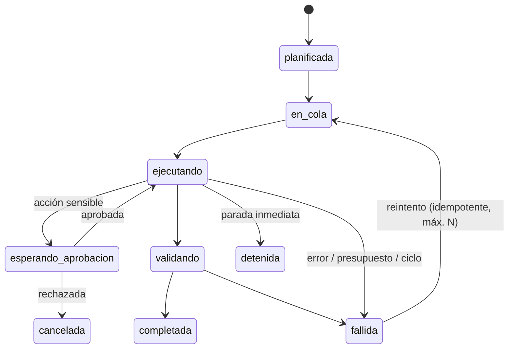

# 06 · Arquitectura del HARNESS agéntico (fase 5)

> Estado: **diseño**. Ningún agente está implementado ni se presenta como activo en la interfaz.

## 1. Flujo
`Investigador → Orquestador → Planificador → Agentes especialistas → Validador → Revisor científico → Publicador autorizado (humano)`

## 2. Modelo de ejecución

- **Cola persistente** en PostgreSQL (o Temporal, ver ADR-5). Cada tarea: `idempotency_key`, `parent_task_id`, `budget_id`, `attempt`, `state`, `input_hash`.
- **Presupuestos** (`agent_budgets`): tokens, costo en centavos, llamadas a herramientas, tiempo de pared. Al agotarse → `fallida` con motivo.
- **Detección de ciclos:** grafo de tareas; se rechaza una subtarea cuyo `input_hash` ya aparece en su ascendencia, y hay profundidad máxima.
- **Parada inmediata:** bandera `kill_switch` por organización y global; los workers la consultan antes de cada paso.
- **Memoria por proyecto:** notas y resúmenes versionados; siempre con referencia a evidencia (`source_id`, fragmento, fecha).
- **Registro de herramientas:** cada `agent_tool_calls` guarda herramienta, versión, argumentos (redactados), resultado resumido, costo, duración.
- **Permisos de herramientas:** cada definición de agente declara herramientas permitidas; el contenido obtenido de fuentes externas es **dato no confiable**: nunca cambia instrucciones, no da acceso a secretos ni habilita herramientas nuevas.
- **Aprobación humana** obligatoria para: publicar, enviar comunicaciones a participantes, activar conectores, gastar por encima de umbral, crear agentes.

## 3. Catálogo inicial: 36 agentes en 12 familias

| Familia | Agentes |
|---|---|
| 1 Planificación | Director de investigación · Planificador metodológico · Coordinador de tareas |
| 2 Investigación documental | Fuentes · Búsqueda documental · Verificación y citas |
| 3 Recolección | APIs · Rastreo web autorizado · Sincronización |
| 4 Redes sociales | Comentarios · Temas y tendencias · Integridad de conversaciones |
| 5 Demoscopia | Cuestionarios · Muestreo · Validación de entrevistas |
| 6 Estadística | Ponderación · Modelado · Incertidumbre |
| 7 Encuesta de encuestas | Descubrimiento · Homologación · Agregación estadística |
| 8 Inteligencia geográfica | Territorial · Datos censales · Visualización cartográfica |
| 9 Interpretación | Lenguaje natural · Análisis multimodal · Síntesis investigativa |
| 10 Informes | Redactor científico · Visualizaciones · Auditoría editorial |
| 11 Seguridad y cumplimiento | Privacidad · Licencias y permisos · Controles y riesgos |
| 12 Operaciones | Observabilidad · Costos · Evaluación de calidad |

Cada definición (`agent_definitions` + `agent_versions`): propósito, entradas/salidas con esquema JSON, herramientas permitidas, modelo preferido y alternativos, presupuesto por defecto, criterios de evaluación, responsable humano.

## 4. Creación de agentes nuevos
Un agente autorizado puede **proponer** una definición a partir de una plantilla. La propuesta queda en `agent_approvals` y solo se activa con aprobación de un administrador (`agents.approve`). Límites: máximo de agentes por organización, sin permisos superiores a los de su proponente, sin capacidad de crear agentes a su vez. Prohibida la autorreplicación.

## 5. Centro de IA multimodelo
Interfaz `ModelProvider { complete, embed, transcribe }` con adaptadores para Anthropic, OpenAI y Google, versiones de API fijadas y verificadas al implementar. Enrutador por tarea (clasificación, extracción, síntesis), costo y disponibilidad; fallback solo entre proveedores autorizados para el tipo de dato. Documentos de un cliente no se envían a un proveedor externo sin base de autorización registrada. Caché semántica por organización (nunca compartida). Evaluaciones automáticas: exactitud de citas, afirmaciones sin respaldo, consistencia.

## 6. Salidas
Toda respuesta investigativa separa: **evidencia observada** (con cita) · **inferencia del modelo** · **hipótesis** · **conclusión estadística** (con método e incertidumbre).
